<div align="center">

<picture>
  <source media="(prefers-color-scheme: dark)" srcset="docs/assets/readme/banner-dark.svg">
  
</picture>

**Şirketinizin bütün İK süreçleri tek platformda — açık kaynak, kendi sunucunuzda, KVKK'ya göre tasarlanmış.**

[](https://github.com/barisshn35/hr360/actions/workflows/ci.yml)
[](https://github.com/barisshn35/hr360/releases)
[](LICENSE)
<br>


[Hızlı başlangıç](#-hızlı-başlangıç) ·
[Neler sunar](#-neler-sunar) ·
[Ekranlar](#-ekranlar) ·
[Mimari](#-mimari) ·
[Güvenlik ve KVKK](#-güvenlik-ve-kvkk) ·
[Belgeler](#-belgeler)

<br>

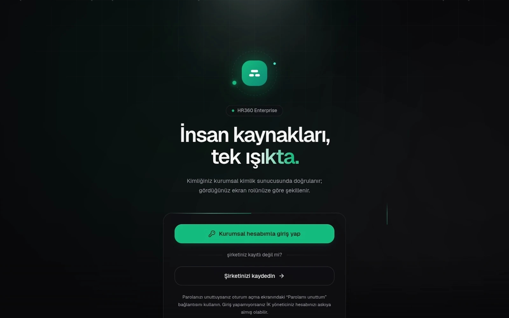

</div>

---

HR360, şirketlerin insan kaynakları süreçlerini tek yerden yönettiği, **çok kiracılı** (bir kurulumda
birden çok şirket) bir İK platformudur. Tek bir sunucuya tek komutla (`./install.sh`) kurulur;
**bütün veriler sizin sunucunuzda kalır.** KVKK gereksinimleri (veri en aza indirme, hassas alanların
şifrelenmesi, erişim kaydı, saklama ve imha) ürünün temel parçasıdır. Paket, kullanıcı ya da çalışan
sınırı yoktur: her şirket bütün modülleri kullanır.

<table>
<tr>
<td width="33%" valign="top">

**🏠 Kendi sunucunuzda**<br>
Tek komutla kurulum, HTTPS otomatik. Veri, anahtar ve parolalar yalnızca sizin sunucunuzda üretilir ve saklanır.

</td>
<td width="33%" valign="top">

**🛡️ KVKK odaklı**<br>
Envanter, açık rıza, başvurular, saklama ve imha ekranları; hassas alanlar AES-256-GCM ile şifreli, denetim kaydı değiştirilemez.

</td>
<td width="33%" valign="top">

**✉️ E-postasız da çalışır**<br>
Hesap açma ve parola sıfırlama süreli, tek kullanımlık davet linkiyle (kopyala / QR). SMTP sonradan arayüzden eklenebilir.

</td>
</tr>
</table>

## ✨ Neler sunar

| | Alan | Modüller |
|:-:|---|---|
| 👥 | **Çalışan ve organizasyon** | Çalışan kaydı, fotoğrafı ve self-servis profil, organizasyon şeması (2B ve 3B), departman ve ekipler, Excel'den ya da uygulama içi tablodan toplu içe aktarma (çalışan, departman, ekip), zimmet, işe giriş (onboarding) ve işten ayrılış (offboarding) |
| 🗓️ | **İzin, vardiya ve zaman** | İzin talebi ve bakiyeleri (saatlik izin, yasal hak, devir), vardiya planı ve takas, puantaj, fazla mesai, giriş-çıkış terminali (QR, kart, PIN; biyometri yok) |
| 💰 | **Ücret ve bordro** | Türkiye bordrosu (brütten nete, SGK/GV/damga, kümülatif matrah), APHB, banka ve muhasebe dosyaları, e-bordro, kıdem/ihbar, avans, yan haklar, zam dönemi, ücret bantları |
| 🧾 | **Masraf ve seyahat** | Masraf beyanı (TCMB kuru, km masrafı, limitler, yerel fiş okuma), seyahat talebi ve harcırah |
| 🚀 | **Yetenek** | İşe alım (kariyer sayfası, aday hattı, mülakat, teklif), performans (hedef, değerlendirme, 9-kutu, kalibrasyon), eğitim ve sertifika, yetkinlik matrisi, mentorluk, iç ilanlar |
| ✅ | **Onay ve belgeler** | Çok adımlı onay akışları, vekâlet, e-postadan tek tıkla karar, belge talebi ve doğrulama kodu, basit elektronik imza, duyurular ve doküman kütüphanesi |
| ⚖️ | **Uyum** | KVKK ekranları (envanter, açık rıza, başvurular, saklama ve imha), değiştirilemez denetim kaydı, etik hattı, İSG, disiplin |
| 💬 | **Çalışan deneyimi ve içgörü** | Takdir duvarı, ayın çalışanı oylaması (departman bazında, katsayılı ve gizli oy, kazananlar sıralaması), anket ve eNPS, ekip sağlığı paneli, 1:1 defteri, analitik ve doğal dilde rapor, devir riski modeli (yalnızca öneri) |
| 🔌 | **Entegrasyonlar** | Slack ve Microsoft Teams'ten onay, Google/Microsoft 365 takvim ve Zoom, SSO, SCIM 2.0 ve LDAP/AD, webhook ve açık REST API (Zapier, n8n), PWA ve anlık bildirim |

Panel **Türkçe ve İngilizcedir**. "AI" etiketli özellikler yerel, kural tabanlı ve istatistiksel
yöntemlerle çalışır; büyük dil modeli (LLM) yalnızca isterseniz ve şirket yöneticisi açarsa kullanılır.
Modüllerin ayrıntılı anlatımı: [docs/kullanim](docs/kullanim/README.md).

## 🖼️ Ekranlar

<table>
<tr>
<td width="50%"><b>İzin talebi</b> — çalışan talep eder, onay zinciri başlar<br>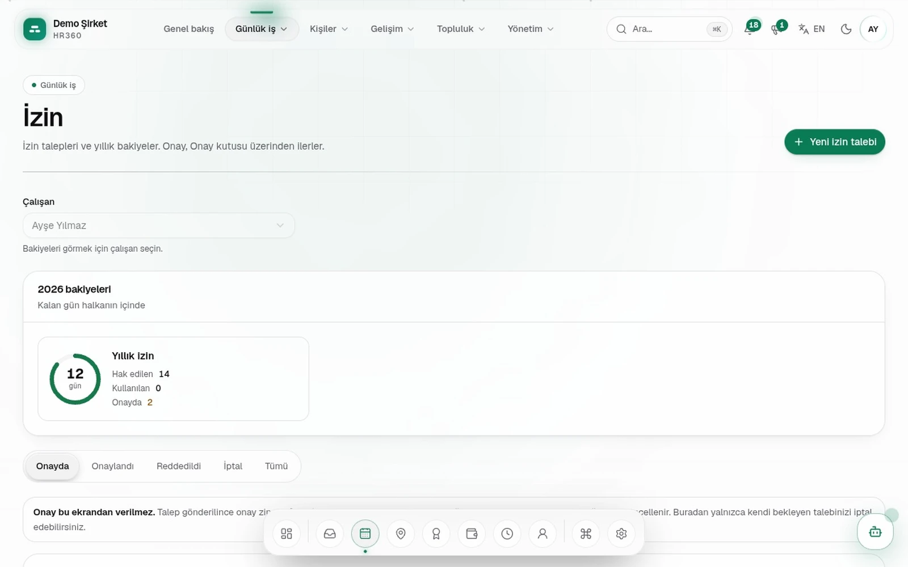</td>
<td width="50%"><b>3B organizasyon görünümü</b> — sürükleyerek döndürün<br>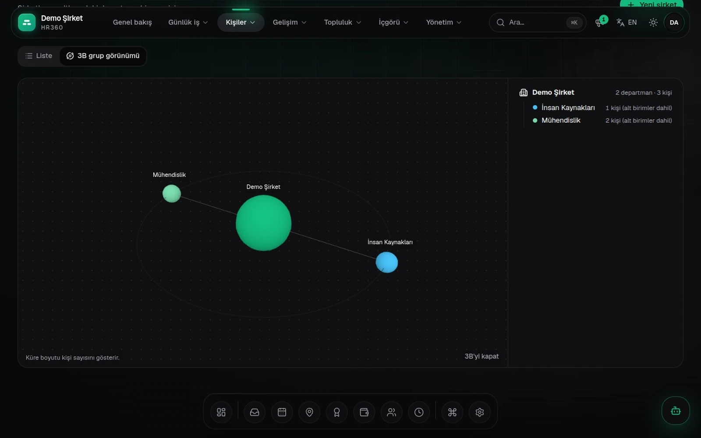</td>
</tr>
<tr>
<td><b>Genel bakış</b> (koyu tema)<br>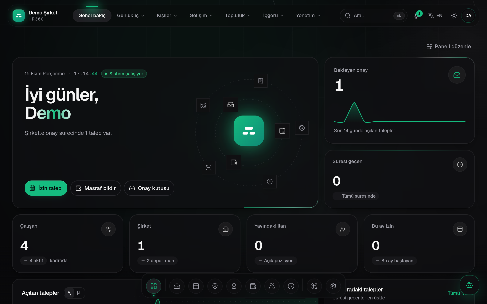</td>
<td><b>Genel bakış</b> (açık tema)<br>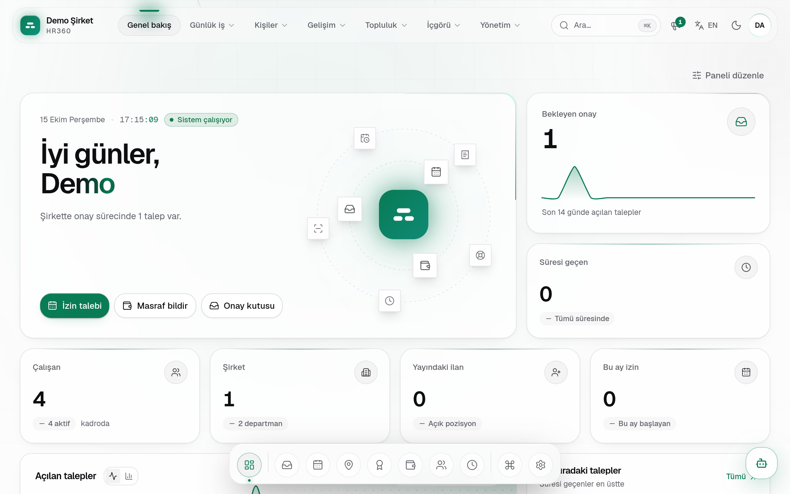</td>
</tr>
<tr>
<td><b>Çalışanlar</b><br>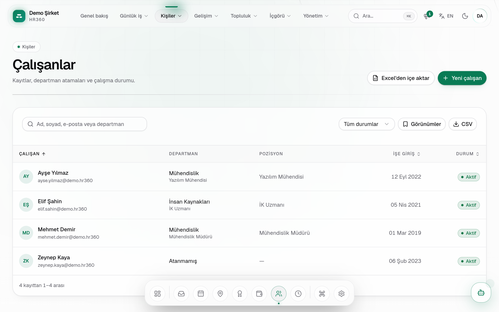</td>
<td><b>İzin ve bakiyeler</b><br>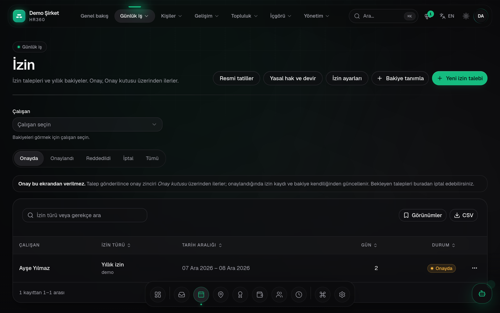</td>
</tr>
</table>

<details>
<summary><b>Giriş ekranı</b></summary>
<br>
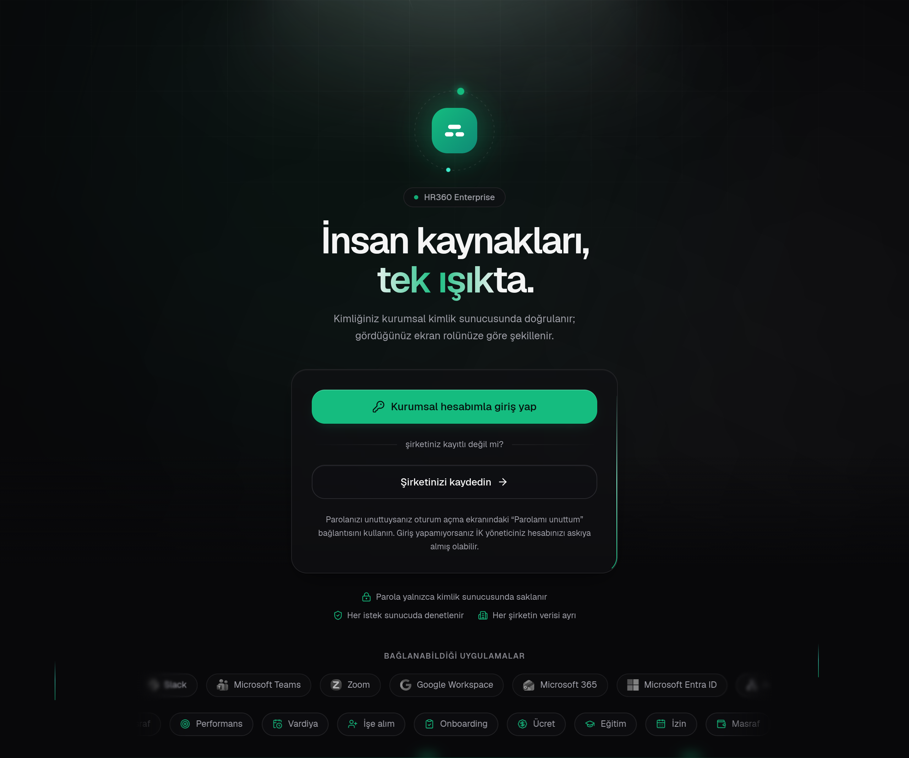
</details>

Görüntüler kurulumla gelen isteğe bağlı **demo şirketinden** alınmıştır; kişiler ve veriler kurgusaldır.

## 🚀 Hızlı başlangıç

```bash
git clone https://github.com/barisshn35/hr360.git && cd hr360
./install.sh
```

Betik birkaç soru sorar; parola ve anahtarlar için Enter'a basarsanız güçlü, rastgele değerler
üretilir. Repoda hiçbir gerçek parola ya da anahtar yoktur: hepsi kurulumda sunucunuzda üretilir ve
yalnızca yerel `.env` dosyasında (git'e girmez) saklanır. İlk kurulum, imajlar derlendiği için birkaç
dakika sürer.

> [!TIP]
> Kendi bilgisayarınızda denemek için `./install.sh --demo` çalıştırıp soruları boş geçin:
> uygulama örnek `demo` şirketiyle `http://localhost` adresinde açılır.

**Gerçek sunucu, soru sormadan:**

```bash
HR360_SMTP_PASSWORD='uygulama-sifresi' ./install.sh --yes \
  --domain hr.sirket.com --email it@sirket.com --smtp-from ik@sirket.com
```

<details>
<summary><b>Gereksinimler</b></summary>

| | |
|---|---|
| İşletim sistemi | Ubuntu, Debian, RHEL, Rocky, AlmaLinux, Oracle Linux, Fedora, Amazon Linux, openSUSE/SLES, Arch, Alpine (Windows'ta WSL2, macOS'ta Docker Desktop). Sisteme özel adımlar: [docs/kurulum/isletim-sistemleri.md](docs/kurulum/isletim-sistemleri.md) |
| Yazılım | Docker Engine + Docker Compose v2 eklentisi (yoksa `install.sh` kurmayı teklif eder), `curl`, `openssl` |
| İşlemci ve bellek | En az **2 vCPU / 8 GB** RAM, önerilen 4 vCPU / 16 GB |
| Disk | En az **40 GB** boş alan (imajlar ve derleme yaklaşık 20 GB tutar) |
| DNS | Alan adının (ör. `hr.sirket.com`) A kaydı sunucunun genel IP'sini göstermeli |
| Ağ | Dışarıya yalnızca **80** ve **443/tcp** açık; SSH (22) yalnızca yönetim IP'lerine (Keycloak paneli `port` moduna alınırsa 8090 da) |

**Kapasite:** 2 vCPU / 8 GB'ta 100 eşzamanlı kullanıcı, p95 ≈ 46 ms (k6 yük testi, sıfır hata).
Her servisin tek kopyası çalışır; daha büyük kurulumlar için bkz. [docs/mimari](docs/mimari/README.md#7-bilinen-sınırlar).

</details>

<details>
<summary><b>Kurulum seçenekleri</b></summary>

| Seçenek | Ne yapar |
|---|---|
| `--domain ALAN_ADI` | Adres `https://ALAN_ADI` olur; HTTPS Let's Encrypt ile otomatik alınır ve yenilenir. DNS henüz hazır değilse geçici sertifikayla açılır, Let's Encrypt saatte bir yeniden denenir. |
| `--email ADRES` | Yönetici e-postası: sertifika bildirimleri, sistem uyarıları ve SMTP deneme e-postası. `platform.admin` hesabının e-postası da bu olur. |
| `--smtp-from ADRES` | Gönderen adres; SMTP sunucusu ve portu adresten bulunur (Gmail/Google Workspace, Microsoft 365, Outlook, Yandex, Zoho, MX kaydı) ve deneme e-postasıyla doğrulanır. |
| `--mail-mode self` | (Gelişmiş, yalnızca alan adlı kurulum) **Sunucu kendisi göndersin:** paketteki Postfix e-postaları alıcılara doğrudan teslim eder ve DKIM ile imzalar; ayrı bir e-posta hesabı gerekmez. 25/tcp çıkışı, PTR (ters DNS) kaydı ve SPF/DKIM/DMARC kayıtları gerekir; kurulum ilk ikisini denetler, DNS kayıtlarını yazar. Varsayılan değildir. Ayrıntı: [işletim kılavuzu](docs/isletim/README.md#sunucunun-kendi-posta-servisi). |
| `--demo` | Demo verisini kurar: `demo` şirketi ve `demo.admin` kullanıcısı. Üretimde vermeyin. Sorulu kurulumda "Demo verisi kurulsun mu? [e/H]" sorulur, varsayılan **Hayır**. |
| `--no-signup` | Herkese açık şirket kaydını kapatır (`PUBLIC_SIGNUP_ENABLED=false`): giriş ekranında "Şirketinizi kaydedin" görünmez, `/kayit` "Kayıt kapalı" der, kayıt uçları 404 döner. Sonradan **Platform › Sistem ayarları**'ndan değiştirilebilir. |
| `--keycloak-admin KİP` | Keycloak yönetim paneli erişimi: `open`, `ip:CIDR,...` ya da `port`. Varsayılan **`open`**: panel ana adreste (`/auth/admin/`) açıktır. Dış güvenlik duvarından kısıtlamak için sonradan `scripts/keycloak-admin-access.sh port` ile 8090'a taşıyın. |
| `--url`, `--tls`, `--cert/--key`, `--smtp-host`, `--smtp-port`, ... | Tüm seçenekler: `./install.sh --help`; değişkenlerin açıklamalı listesi: [.env.example](.env.example) |

**Dış güvenlik duvarı.** Betik sunucunun kendi güvenlik duvarına (ufw/firewalld) dokunmaz; yerel
duvar portları engelliyorsa yalnızca uyarır. Bulut güvenlik grubunda (AWS Security Group, Azure NSG,
GCP firewall) ya da vCloud Edge Gateway'de 80 ve 443/tcp'yi gelen trafiğe açın; Keycloak panelini
`port` moduna aldıysanız **8090/tcp'yi yalnızca yönetim IP'lerine açın**. Ayrıntı:
[docs/runbooks/keycloak-yonetim-paneli-erisimi.md](docs/runbooks/keycloak-yonetim-paneli-erisimi.md).

Veritabanı, MinIO, Mailpit ve MLflow yalnızca sunucunun kendisine (`127.0.0.1`) açılır; uzaktan
erişim için SSH tüneli kullanın. Kurulum sonunda HTTPS, yönlendirme ve giriş adresi denetlenip
özette gösterilir (`scripts/tls.sh verify`).

</details>

<details>
<summary><b>E-posta: test kutusu, kendi SMTP'niz ya da sunucunun kendi posta servisi</b></summary>
<br>

Gönderen adres verilmezse paketteki **Mailpit** kullanılır: e-postalar kimseye ulaşmaz, yalnızca
sunucudaki test kutusunda (`http://localhost:8025`) görünür. E-posta olmadan da ürün tam çalışır:
hesap açma ve parola sıfırlama **süreli, tek kullanımlık davet linkiyle** yapılır; link yöneticiye
gösterilir (kopyala / QR). Gerçek SMTP sunucusunu kurulumda `--smtp-from` ile ya da sonradan
arayüzden tanımlayın: **Platform › Sistem ayarları** (`/panel/platform/sistem`; deneme e-postası ve
test kutusuna dönüş de orada). E-posta hesabı vermek istemeyen, alan adlı kurulumlar isteğe bağlı
olarak sunucunun kendi posta servisini (`--mail-mode self`) kullanabilir; bunun için DNS'te kayıt
eklemek ve sağlayıcıdan PTR kaydı istemek gerekir.

</details>

### İlk giriş ve ilk şirket

HR360'ta iki tür yönetici vardır: **platform yöneticisi** (`platform.admin`; kurulumun sahibi, şirketleri
yönetir, hiçbir şirkete üye değildir) ve her şirketin kendi **şirket yöneticisi**. Parolalar
`.env` dosyasındadır; kurulum özeti hangi değişkene bakacağınızı söyler.

1. `https://ALAN_ADI` adresinde `platform.admin` ile giriş yapın (parola: `.env` içindeki
   `PLATFORM_ADMIN_PASSWORD`). Platform yöneticisi hesabında iki adımlı doğrulamayı açmanız önerilir;
   yeni şirketlerde iki adımlı doğrulama herkes için varsayılan olarak zorunludur (şirket yöneticisi
   **Güvenlik** ekranından gevşetebilir).
2. İlk şirketi açın: **Platform › Kiracılar** (`/panel/platform/kiracilar`) › **Yeni kiracı**.
   Şirket adı, kısa ad ve şirket yöneticisinin e-postası girilir; Keycloak'ta şirketin
   organizasyonu ve yönetici hesabı oluşturulur; şirket yöneticisinin **süreli parola linki** size bir
   kez gösterilir (kopyala / QR), e-posta açıksa yöneticiye e-postayla da gider. Link kaybolursa
   kiracı ayrıntısındaki **Yönetici parola linki** ile yenisini üretin.
3. Şirket yöneticisi kendi hesabıyla girer; departmanları, çalışanları ve İK yöneticilerini ekler,
   çalışanlara giriş erişimi verir (her biri için süreli parola linki; **Roller › Davetler ve parola
   linkleri** listesinden izlenir, iptal edilir ya da yeniden üretilir). Şirket, parola belirleme
   yöntemini **Ayarlar**'dan "Keycloak e-postası" (eski yöntem; platform SMTP'si gerekir) yapabilir.

<details>
<summary><b>Herkese açık kayıt, demo kurulumu ve ilk kontroller</b></summary>
<br>

**Herkese açık kayıt (isteğe bağlı):** açıksa (varsayılan) şirketler kendileri de kaydolabilir:
giriş ekranındaki **Şirketinizi kaydedin** bağlantısı ya da `https://ALAN_ADI/kayit`. Şirketleri
yalnızca siz açacaksanız kaydı kapatın: kurulumda `--no-signup`, sonradan **Platform › Sistem ayarları**'ndan.
Platformun "Yeni kiracı" yolu kaydın açık ya da kapalı olmasından bağımsızdır.

**Yasal metinler ve iletişim:** SSS, gizlilik politikası, kullanım koşulları ve iletişim sayfaları
(giriş ekranının alt bilgisi) **Platform › Sistem ayarları › Herkese açık site**'den doldurulur; boş
metin için KVKK'ya göre hazırlanmış varsayılan şablon gösterilir. Arama motorlarına görünürlük
varsayılan kapalıdır (`robots.txt`, `noindex`); aynı ekrandan açılabilir.

**Demo kurulumu (`--demo`):** `demo.admin` ile giriş yapın (parola: `.env` içindeki
`DEMO_ADMIN_PASSWORD`). Bu hesap yalnızca örnek `demo` şirketinin yöneticisidir; tüm şirketleri
`platform.admin` yönetir. Demo şirketi **Platform › Kiracılar** ekranından askıya alınabilir.
`HR360_DEMO` değişkeni hiç olmayan eski kurulumlar demo şirketini korur (geriye uyumluluk).

**İlk kontroller:** kendinize bir çalışan kaydı açıp davet gönderin, e-posta geliyor mu bakın;
`scripts/tls.sh status` sertifika bitiş tarihini ve "Otomatik yenileme: calisiyor" satırını
göstermeli; `.env` dosyasını (bütün parolalar burada) güvenli bir yere yedekleyin. Kurulumda üretilen
parolalar bir yerde göründüyse yenileyin: `python3 scripts/rotate-passwords.py [--keycloak-admin]`
(yeni parolalar ekrana basılmaz, `.env`'e yazılır).

</details>

<details>
<summary><b>Güncelleme</b></summary>

```bash
scripts/update.sh --ref v1.0.0     # belirli sürüme
scripts/update.sh                  # izlenen dalın en yeni hâline
scripts/update.sh status           # kurulu sürüm ve son güncelleme
scripts/update.sh rollback         # son güncellemeden önceki sürüme dön
```

`update.sh` önce yedek alır, sonra kodu yeni sürüme getirir, veritabanı göçlerini uygular, imajları
yeniden derler ve tüm servislerin sağlık denetimini yapar; denetim geçmezse önceki sürüme kendiliğinden
döner. Kurulu sürüm repodaki `VERSION` dosyasındadır ve uygulamada hesap menüsünde görünür. Seçenekler:
`--no-backup`, `--restore-db`, `--timeout SN`, `--yes` (`scripts/update.sh --help`). `./install.sh`'yi
mevcut kurulumda yeniden çalıştırmak da güncelleme yapar (sırlar korunur).

</details>

<details>
<summary><b>Yedekleme ve geri yükleme</b></summary>

```bash
scripts/backup.sh                                   # anlık yedek → backups/hr360-YYYYmmdd-HHMMSS.tar.gz.enc
scripts/backup.sh schedule --at 03:15 --keep 30 --verify-weekly   # gece yedeği + haftalık geri yükleme testi
scripts/backup.sh verify [arşiv]                    # geçici veritabanına geri yükleyerek doğrula
scripts/restore.sh backups/hr360-….tar.gz.enc [--with-env] [--only-db] [--yes]
```

`scripts/backup.sh` üç veritabanını (`hr360_operational`, `keycloak`, `hr360_mlflow`) `pg_dump` ile
ve MinIO verisini (logolar, belgeler, ML modelleri) tek arşive yazar; arşivde `MANIFEST` ve
`SHA256SUMS` bulunur, `--keep N` en yeni N yedeği tutar. Servisler çalışırken alınabilir.
`--with-env` `.env`'i de ekler: bütün parolalar bu dosyadadır, arşivi buna göre saklayın.

- **Şifreleme (KVKK m.12):** kurulum `.env`'e `BACKUP_ENCRYPTION_KEY` yazar; arşiv AES-256 ile
  şifrelenir. Anahtar olmadan yedek açılamaz; anahtarı yedeklerden ayrı bir yerde (parola kasası) saklayın.
- **Dış depo:** `.env`'e `BACKUP_S3_ENDPOINT`, `BACKUP_S3_BUCKET`, `BACKUP_S3_ACCESS_KEY`,
  `BACKUP_S3_SECRET_KEY` (isteğe bağlı `BACKUP_S3_PREFIX`) yazılırsa şifreli arşiv S3 uyumlu depoya
  da gönderilir. Yurt dışındaki bilinen sağlayıcılara KVKK m.9 dayanağı olmadan gönderilmez
  (dayanak varsa `BACKUP_S3_ABROAD_OK=1`).
- **Geri yükleme:** `scripts/restore.sh` arşivi doğrular, uygulamayı durdurur, veritabanlarını
  **silip** arşivdekiyle yeniden oluşturur, MinIO'yu geri yükler ve servisleri başlatır. Bittiğinde
  saklama politikaları hemen yeniden çalışır (yedekten sonra imha edilmiş kayıtlar geri gelmesin);
  yedek tarihinden sonra yerine getirilmiş silme başvurularını KVKK › Başvurular ekranından kontrol edin.
- **Yeni sunucuya taşıma:** önce `./install.sh`, sonra `scripts/restore.sh <arşiv> --with-env`.
  Şifreli alanlar `.env`'deki anahtarlarla açıldığı için veri ve `.env` birlikte taşınmalıdır.
- **Kaldırma:** `./uninstall.sh` önce son yedeği (arşiv, `.env`, sertifikalar, realm şablonu) kurulum
  klasörünün dışına alır, zamanlanmış işleri ve konteynerleri kaldırır, verileri siler. `--keep-data`
  verileri korur, `--purge` klasörü de siler, `--dry-run` yalnızca ne yapacağını gösterir (`./uninstall.sh --help`).
- Arşive girmeyen ama ayrıca saklanması gerekenler: `deploy/keycloak/realm-export.json` ve
  sertifikalar (`deploy/letsencrypt/`, kendi sertifikanızsa `deploy/nginx/tls/`). Arşivleri sunucunun
  dışına da kopyalayın. Değişmez kopya, imzalı özet ve geri yükleme tatbikatı:
  [docs/guvenlik](docs/guvenlik/README.md#yedekler-değişmez-kopya-imzalı-özet-geri-yükleme-tatbikatı).

</details>

## 🏗️ Mimari

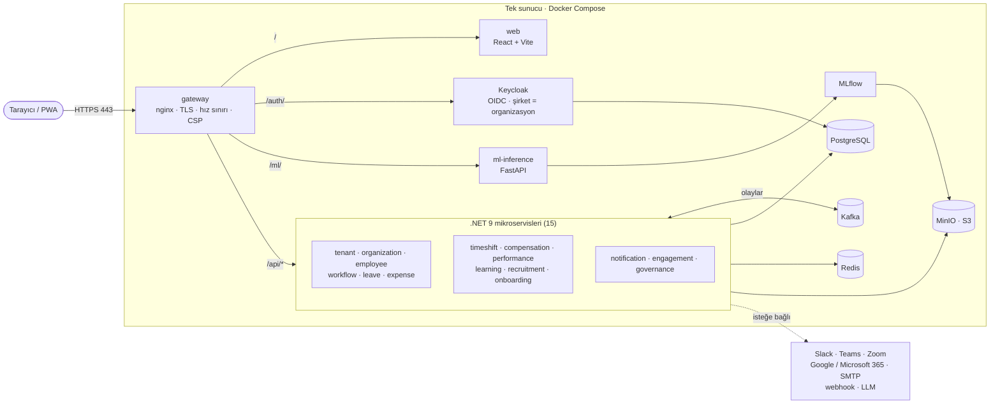

Her servis kendi şemasında ve kendi veritabanı rolüyle çalışır; servisler arası iletişim Kafka
olaylarıyla (saga ve outbox) yürür. Ayrıntılı C4 diyagramları, olay kataloğu ve servis uçları:
[docs/mimari](docs/mimari/README.md) · [servisler.md](docs/mimari/servisler.md).

## 🛡️ Güvenlik ve KVKK

- **Repoda sır yok:** bütün parola ve anahtarlar kurulumda sunucuda üretilir.
- **Dar saldırı yüzeyi:** dışarıya yalnızca gateway (80, 443; ayrı port modunda 8090) açılır; veri
  servisleri yalnızca `127.0.0.1`'dedir. Hiçbir uygulama konteyneri root çalışmaz.
- **Gateway korumaları:** hız sınırı ve katı içerik güvenliği politikası (CSP). Üretimde Swagger
  kapalıdır; API belgeleri yalnızca oturum açmış kullanıcıya uygulama içinden sunulur.
- **Veri koruma:** TCKN/IBAN gibi hassas alanlar AES-256-GCM ile şifrelenir; denetim kaydı hash
  zinciriyle değiştirilemezdir; yedekler şifrelidir.
- **KVKK ekranları:** kişisel veri envanteri, aydınlatma ve açık rıza, ilgili kişi başvuruları,
  saklama süreleri ve otomatik imha; yurt dışına aktarım uyarıları.
- **Sürekli tarama:** CI'da bağımlılık, gizli anahtar, Dockerfile/compose ve imaj taramaları (Trivy),
  SBOM üretimi, haftalık temiz kurulum ve ZAP taraması.

Kurulum sonrası kontrol listesi ve kabul edilen riskler: [docs/guvenlik](docs/guvenlik/README.md#kurulum-kontrol-listesi) ·
KVKK uyumu: [docs/kvkk](docs/kvkk/README.md) · Açık bildirimi: [SECURITY.md](SECURITY.md).

## 🔌 Entegrasyonlar

<p align="center">
  &nbsp;&nbsp;&nbsp;
  &nbsp;&nbsp;&nbsp;
  &nbsp;&nbsp;&nbsp;
  &nbsp;&nbsp;&nbsp;
  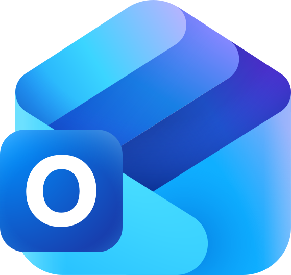&nbsp;&nbsp;&nbsp;
  &nbsp;&nbsp;&nbsp;
  &nbsp;&nbsp;&nbsp;
  &nbsp;&nbsp;&nbsp;
  &nbsp;&nbsp;&nbsp;
  <picture><source media="(prefers-color-scheme: dark)" srcset="docs/assets/readme/logos/openai-white.svg"></picture>&nbsp;&nbsp;&nbsp;
  <picture><source media="(prefers-color-scheme: dark)" srcset="docs/assets/readme/logos/anthropic-white.svg"></picture>&nbsp;&nbsp;&nbsp;
  <picture><source media="(prefers-color-scheme: dark)" srcset="docs/assets/readme/logos/ollama-white.svg"></picture>
</p>

Slack, Microsoft Teams, Mattermost, Rocket.Chat, Google ve Microsoft 365 takvim, Zoom, Google/Microsoft
SSO, SCIM 2.0 (Entra ID, Okta), LDAP/Active Directory, SMTP, Web Push, webhook/açık API (Zapier, n8n) ve isteğe
bağlı LLM sağlayıcıları (OpenAI uyumlu, Anthropic, Ollama) desteklenir. Hiçbiri zorunlu değildir;
tanımlandıklarında kimlik bilgileri kiracı bazında şifreli saklanır. Kurulum adımları:
[docs/kullanim](docs/kullanim/README.md#yapılandırma-gerektirenler).

> [!IMPORTANT]
> Bu entegrasyonlar şimdiye kadar yalnızca sağlayıcıları taklit eden **sahte bir sunucuyla** uçtan
> uca test edildi; gerçek hesaplarla doğrulanmadı. Canlıya almadan önce gerçek hesapla kontrol
> listesini uygulayın: [docs/entegrasyonlar/dogrulama.md](docs/entegrasyonlar/dogrulama.md).
> Markalar ve logolar sahiplerine aittir.

## ⚠️ Bilinen sınırlar

- **Devir (işten ayrılma) riski modeli** şirket verisiyle eğitilene kadar **sentetik veriyle**
  eğitilmiş modeldir. Şirket verisiyle eğitim şirket yöneticisinin açık iznine bağlıdır; skor yalnızca
  öneridir, tek başına karar için kullanılamaz. Bkz. [docs/ml](docs/ml/README.md).
- **Bordro parametreleri** (asgari ücret, SGK/işsizlik oranları, tavan, vergi dilimleri, istisnalar)
  kullanıcı tarafından girilir ve doğrulanır; gelen değerler örnektir.
- **Resmî dosya düzenleri** (SGK APHB, banka toplu ödeme, muhasebe fişi) sertifikalı değildir ve
  resmî sistemlerde gerçek hesapla denenmedi; yüklemeden önce güncel şablonla karşılaştırın. HR360
  SGK, banka ya da muhasebe yazılımına bağlanmaz, yalnızca dosya üretir. Bkz. [docs/bordro](docs/bordro/README.md).
- **Tek sunucu:** her servisin tek kopyası çalışır; Kafka, PostgreSQL ve Keycloak tek düğümdür,
  yük dengeleme ve yedek sunucu yoktur. Bkz. [docs/mimari](docs/mimari/README.md#7-bilinen-sınırlar).
- **Basit elektronik imza** 5070 sayılı Kanun kapsamında nitelikli (güvenli) e-imza değildir.

## 📚 Belgeler

| Belge | İçerik |
|---|---|
| [docs/kullanim](docs/kullanim/README.md) | Modüller ve özellikler, entegrasyon kurulumları, beyaz etiketleme, özel alan adı, SCIM/LDAP, e-imza |
| [docs/isletim](docs/isletim/README.md) | Yönetim komutları, e-posta, izleme ve alarmlar, bakım ve hata sayfaları, testler |
| [docs/kurulum/isletim-sistemleri.md](docs/kurulum/isletim-sistemleri.md) | İşletim sistemine göre kurulum adımları |
| [docs/runbooks](docs/runbooks/) | [HTTPS](docs/runbooks/https.md), [Keycloak yönetim paneli](docs/runbooks/keycloak-yonetim-paneli-erisimi.md), [izleme alarmları](docs/runbooks/izleme-alarmlari.md), [izleme saklama](docs/runbooks/izleme-saklama.md), [yavaş sorgu](docs/runbooks/yavas-sorgu.md), [Keycloak PostgreSQL geçişi](docs/runbooks/keycloak-postgres-gecisi.md) |
| [docs/guvenlik](docs/guvenlik/README.md) | Güvenlik katmanları, sıkılaştırma kontrol listesi, anahtar yenileme, kabul edilen riskler |
| [docs/kvkk](docs/kvkk/README.md) | KVKK uyumu: envanter, rıza, başvurular, saklama ve imha |
| [docs/bordro](docs/bordro/README.md) | Türkiye bordrosu, dosya düzenleri ve doğrulanmamış noktalar |
| [docs/ml](docs/ml/README.md) | Makine öğrenmesi model kartları |
| [docs/mimari](docs/mimari/README.md) | Mimari, diyagramlar, Kafka olay kataloğu; servis uçları: [servisler.md](docs/mimari/servisler.md) |
| [docs/entegrasyonlar/dogrulama.md](docs/entegrasyonlar/dogrulama.md) | Gerçek hesaplarla entegrasyon doğrulama listesi |
| [docs/dil](docs/dil/README.md) | Türkçe/İngilizce arayüz ve çeviri kuralları |
| [docs/CHANGELOG-tr.md](docs/CHANGELOG-tr.md) | Değişiklik günlüğü |
| [tests/README.md](tests/README.md) | Testler (birim, entegrasyon, tarayıcı) |

<details>
<summary><b>Depo yapısı</b></summary>

```
apps/
  web/                   React + Vite web arayüzü (PWA)
  ml-inference/          FastAPI ML servisi (devir riski, AI araçları, fiş okuma)
  ml-platform/           MLflow sunucusu
  services/              15 .NET 9 mikroservisi: tenant, organization, employee, workflow, leave,
                         timeshift, performance, learning, compensation, expense, recruitment,
                         onboarding, notification, engagement, governance (bkz. docs/mimari/servisler.md)
data/migrations/         Birleşik SQL şeması (boş kurulum)
deploy/
  nginx/                 Gateway yapılandırması ve bakım/hata sayfaları (tls/, acme/, keycloak-admin/ betiklerle doldurulur)
  keycloak/              Realm şablonu (sırlar kurulumda doldurulur) ve giriş ekranı teması
  mailer/                İsteğe bağlı "sunucu kendisi göndersin" posta servisi (Postfix + OpenDKIM)
  postgres/              Ek veritabanları ve servis rolleri
  monitoring/            Prometheus, alarm kuralları, Alertmanager, Loki, Tempo, Grafana panoları
  letsencrypt/           Let's Encrypt sertifikaları (git'e girmez)
  testing/               Test ortamı ekleri (sahte sağlayıcı, OpenLDAP)
scripts/                 Yönetim betikleri: update, backup, restore, tls, smtp, monitoring,
                         keycloak-*, rotate-*, crypto-keys, db-roles, secrets-migrate, schedule,
                         security-scan, test, loadtest; sql/ veritabanı göçleri (güncellemede otomatik)
tests/                   dotnet/ birim, integration/ API, e2e/ Playwright, install/ kurulum betiği,
                         load/ ve perf/ yük testleri, support/ yardımcılar
docs/                    Belgeler (yukarıdaki dizin)
.github/workflows/       CI (derleme, testler, taramalar), haftalık temiz kurulum ve ZAP taraması
docker-compose.yml       Tek sunucu servis tanımı
install.sh               Kurulum betiği
.env.example             Ortam değişkenlerinin açıklamalı listesi
VERSION                  Ürün sürümü
LICENSE, NOTICE          Lisans (AGPL-3.0) ve telif bildirimleri
```

</details>

## 🤝 Katkı ve destek

- **Hata bildirimi ve öneriler:** [GitHub Issues](https://github.com/barisshn35/hr360/issues).
  Parola, `.env` içeriği, kişisel veri ya da müşteri verisi paylaşmayın.
- **Güvenlik açıkları Issues'a yazılmaz:** [SECURITY.md](SECURITY.md).
- **Sorun giderme için önce:** `docker compose ps`, `docker compose logs -f <servis>`,
  `scripts/tls.sh verify`, `scripts/update.sh status` ve [docs/runbooks](docs/runbooks/).
- **Kod katkısı:** değişikliğinizi testleriyle birlikte gönderin; testlerin nasıl çalıştırıldığı
  [tests/README.md](tests/README.md)'de.

## 📄 Lisans

HR360, GNU Affero Genel Kamu Lisansı 3.0 (**AGPL-3.0**) ile lisanslanmıştır — bkz. [LICENSE](LICENSE)
ve [NOTICE](NOTICE). Değiştirilmiş bir sürümü ağ üzerinden hizmet olarak sunanlar kaynak kodunu
kullanıcılarına açmakla yükümlüdür (AGPL m.13).

<div align="center">
<br>
<sub>HR360 · açık kaynak İK platformu · <a href="https://github.com/barisshn35/hr360">github.com/barisshn35/hr360</a></sub>
</div>
